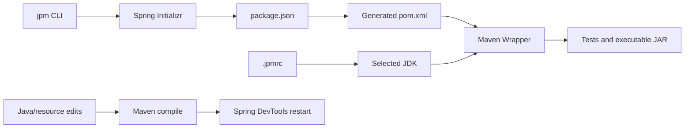

# Architecture

jpm is a Node CLI that coordinates standard Java tools. It does not embed Maven, a JVM, or its own dependency resolver.

## Module map

| Module | Responsibility |
| --- | --- |
| `src/cli.ts` | Parse arguments, route commands, coordinate preflight checks and exit status |
| `src/create.ts` | Fetch/validate Initializr metadata and archive; write the supported project template |
| `src/project.ts` | Validate manifest/dependencies, render POM, guard modifications, preserve modes during writes |
| `src/config.ts` | Parse `.jpmrc`, resolve boundaries/precedence, write JDK choices |
| `src/jdk.ts` | Discover and verify JDKs, construct child environments, validate/download/install Temurin |
| `src/maven.ts` | Run Wrapper process groups, forward signals, poll source changes, serialize compilation |
| `src/doctor.ts` | Aggregate read-only configuration/environment diagnostics |
| `src/validation.ts` | Narrow external records and unknown errors |
| `bin/` | Check the Node baseline, then load compiled CLI modules |

TypeScript 7 compiles sources to ESM in `dist/`. npm ships compiled JavaScript, not a runtime TypeScript compiler. The two direct runtime dependencies are `fast-xml-parser` and `tar`.

## Contracts to preserve

- External JSON/XML is validated at runtime, independently of TypeScript types.
- JSON is authoritative for managed POMs; manual POM edits are detected instead of overwritten.
- Failed preflight does not save a dependency; Maven failure after saving keeps the declaration and explains recovery.
- JDK choice and Java compilation target are distinct. A child environment does not mutate the caller's shell.
- Archive validation limits paths, entry types, and size. JDK downloads are checked against official metadata.
- A failed development compilation does not trigger a successful reload. Signal handling covers Maven's process group.
- Generated Java applications have no npm dependency on jpm or bundled CLI archive. npm is needed to install the CLI, not for each Java build.

Read [configuration](configuration.md), [security](../SECURITY.md), and [validation](../VALIDATION.md) for the practical boundaries of these contracts.
